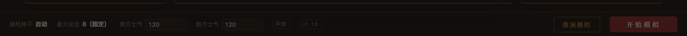

# 推演模拟 · 落地实现文档

> 目标：在主站底栏「开始模拟」旁边新增一个「推演模拟」按钮，点击后用**播片**的方式把这一局战报逐镜推演一遍。
> 本文是落地设计（数据结构 / 算法 / 模块 / 时序 / 接入点 / 测试 / 排期），代码不在本文里写死，但每一处都给出可直接照抄的形状与取值。
>
> 视觉基线：`design-sets/a2-playback.html`（已验收：167 镜 / 65 关键镜 / 三档视口零报错）。
> 数据基线：`design-sets/data/battle.js`（由 `scripts/_design_emit.mts` 生成），本文 §4 说明它如何变成运行时函数。

---

## 1. 目标与边界

### 1.1 要达成的四件事

1. **入口**：`web/main.ts` 底栏控制条 `开始模拟` 左侧新增 `推演模拟`（次按钮样式），键盘 `D` 亦可触发。
2. **不改变现有行为**：`开始模拟` 仍直接出文字战报（`renderBattleView(report,'summary')`），一个像素、一次 `runBattle` 调用、一个种子都不动。
3. **推演即播片**：新开一个全屏推演层，左右两侧是双方六将的实时 HUD（头像 / 兵力三段条 / 状态 chip / 浮动战斗文字），中间是「胶片」——一镜只讲一件事：谁、用什么、打谁、多少伤害、这次的增减伤从哪来。
4. **可回看**：任意跳镜、跳回合、只放关键镜、0.5×–2× 变速；退出后回到配将台，若想要文字版再点「开始模拟」或「看文字战报」。

### 1.2 明确不做（本期）

- 不做 3D / 粒子物理 / WebGL；所有效果仍是 DOM + SVG + CSS。
- 不改引擎（`src/engine/*` 一行不动），不改 golden 快照。
- 不做「边打边算」——推演读的是**已经跑完的完整战报**，因此任意跳镜都零成本。
- 不在推演层里放配将编辑；要改阵容先退出。

### 1.3 完成判据

- [ ] 底栏出现次按钮，点击进入推演层，`runBattle` 只被调用一次。
- [ ] 六将 HUD 的兵力 / 伤兵 / 阵亡三段条在任意跳镜下与战报一致（可以用第 87 镜这种三目标镜头验）。
- [ ] 每一镜都能回答：施法者、战法（或普攻 / 分兵 / 持续）、目标、伤害数值、**本次命中的增减伤来源**。
- [ ] 恢复类在**头像**上浮 `【战法】恢复 +N`；控制 / 增益 / 减益在**全部受影响头像**上浮效果并在卡片 chip 累积层数。
- [ ] 键盘：`空格` 播放/暂停、`←/→` 单镜、`1–8` 跳回合、`Esc` 退出。
- [ ] 1366×768 / 1440×900 / 1920×1080 无横向纵向溢出、无 `pageerror`。
- [ ] `npm test` 全绿（新增单测全部离线、不依赖 DOM 截图）。

---

## 2. 现状盘点（改哪里、为什么）

| 位置 | 现状 | 与本次的关系 |
|------|------|--------------|
| `web/main.ts:493` | `const report = runBattle({ myTeam, enemyTeam, seed, maxRounds: MAX_ROUNDS, awakenedSkillIds })` | 推演复用它，但**自己生成种子**（见 §9.2），避免污染「开始模拟」的种子显示 |
| `web/main.ts:700` | `controlBar.innerHTML` 里 `... <span class="spacer"></span> <button id="start" class="btn">开始模拟</button>` | 在这里插入 `推演模拟` 按钮与监听 |
| `web/main.ts:501` | `recordBattle(report, my, enemy)` 写战报历史 | 推演跑出的战报**是否入历史**要显式决定：建议入（见 §9.4），因为它同样是一次真实对局 |
| `web/main.ts:518` | `closeReportView()` 恢复配将区、清空 `battleRoot` | 推演层要有对称的 `closePlayback()` |
| `web/backButton.ts` | 钩子：`isReportOpen` / `closeReport` / `overlaySelector` | 必须把推演层登记为**最上层**，否则安卓返回键会直接退出应用 |
| `web/styles.css:964` | `.control-bar` 是 flex 行，`#start` 有 `padding:6px 34px; letter-spacing:4px` | 新按钮用 `.btn.ghost` 风格，避免与主按钮抢视觉 |
| `web/styles.css:3` | 设计 token：`--gold:#c49a36`、`--bg:#12100f`、`--panel:#1c1817`、`--font-kai` | 推演层**复用主站 token**，不引入第四套色板 |
| `design-sets/a2-playback.html` | 1054 行的单文件页面，读 `window.BATTLE` | 视觉与交互基线；落地时拆成 `.ts + .css`，数据源换成 `BattleReport` |

> 一句提醒：`design-sets/` 下的四套提案是**静态提案**，不参与 `vite build`（`vite.config.ts` 的 input 只有 `index/advisor/rogue`）。推演模拟是**主站内的真功能**，代码要进 `web/`。

---

## 3. 总体方案

```
┌─ web/main.ts ──────────────────────────────────────────────┐
│  [推演模拟] click                                           │
│     ├─ seed = nextSeed()                                    │
│     ├─ report = runBattle({...})        ← 与开始模拟同一入口 │
│     ├─ const { shots, units } = beatify(report)             │
│     └─ const pv = openPlayback({ report, shots, units,      │
│                                  onExit: () => {} })         │
└─────────────────────────────────────────────────────────────┘
            │
            ▼
┌─ web/playback/playbackView.ts ─────────────────────────────┐
│  全屏层（position:fixed; z-index 高于 .modal-mask）          │
│  ├── .pb-film   左右斜切双联画 + 施法者/目标 立绘            │
│  ├── .pb-flank  左右各 3 张 HUD 卡（兵力 / chip / FCT 宿主） │
│  ├── .pb-head   战法名 / 施法者→目标 / 第 N 回合 · 镜头 i/N  │
│  ├── .pb-foot   兵力基础·属性基础·主加成 + 增减伤来源 chip   │
│  └── .pb-dock   播放·单镜·回合·进度·速度·镜头模式            │
└────────────────────────────────────────────────────────────┘
            ▲
            │ 纯函数，无 DOM
┌─ web/playback/beats.ts ────────────────────────────────────┐
│  beatify(report) → { shots, units }                         │
│  逐事件累积 → 镜头归并 → 快照 → 关键镜判据 → 文案/增减伤解析 │
└─────────────────────────────────────────────────────────────┘
```

三层职责一条线：**引擎产事件 → beats 把事件整理成「镜头」→ view 只负责把第 i 个镜头放出来**。
好处：跳镜 = 直接渲染第 i 镜（无需快进重算），单测只需要测 `beats.ts`。

---

## 4. 数据契约：`BattleReport` → `Shot`

### 4.1 类型（`web/playback/beats.ts` 导出）

```ts
import type { BattleReport, General, SkillType, StatusType } from '../../src/engine/types';

export interface Mods {
  caused?: number;                 // 造成伤害的增伤合计（0.99 = +99%）
  taken?: number;                  // 受到伤害的增伤合计
  reduce?: { n: string; r: number }[]; // 逐条减伤来源 { n: 名称, r: 0.12 }
}

export interface Breakdown { troopBase: number; base: number; main: number }

export interface ShotHit {
  to: string;                                // 目标 unitId
  kind: 'attack' | 'damage' | 'dot' | 'split';
  amount: number;
  skillId?: string;
  skill?: string;                            // 战法名（普攻为 undefined）
  type?: 'physical' | 'strategy';            // 伤害类型（attack/damage 时给）
  dist?: number;                             // 普攻距离
  mods?: Mods;
  bd?: Breakdown;
  after?: number;                            // 本次结算后目标剩余兵力
}

export interface ShotHeal {
  to: string;
  amount: number;
  skill?: string;                            // 必须取 heal 事件自己的 skillName（§13 坑 3）
  before?: number;
  after?: number;
}

export interface ShotStatus {
  to: string;
  st: StatusType;
  detail?: string;
  skill?: string;
}

export interface Shot {
  i: number;                    // 0-based 序号
  round: number;                // 1..8
  actor: string | null;         // 施法者 unitId（状态/持续伤害可能有）
  skill: string | null;         // 战法名（普攻 / 分兵 / 持续伤害为 null）
  type: SkillType | null;       // active | command | passive | pursuit | prepared（无则 null）
  hits: ShotHit[];
  heals: ShotHeal[];
  statuses: ShotStatus[];
  snap: Record<string, number>; // 该镜结束时全六将兵力（用于逐镜回填兵力条）
  key: boolean;                 // 关键镜
}

export interface UnitMeta {
  id: string; name: string; side: 'my' | 'enemy';
  position: '大营' | '中军' | '前锋';
  faction: string; troopType: string;
  maxTroops: number;
  portrait: string; avatar: string;
  redness?: number; level?: number;
}

export function beatify(report: BattleReport): { shots: Shot[]; units: UnitMeta[] };
```

### 4.2 事件 → 镜头映射表

| 引擎事件 | 归属 | 落成镜头字段 | 备注 |
|----------|------|--------------|------|
| `battle_start` / `prep_phase` / `formation_bonus` / `preparation_end` | 丢弃 | — | 不进播片（准备阶段没有目标与数值） |
| `round_start` | 上下文 | `cur.round = e.round` | 回合切换要清空 chip 状态 |
| `unit_act_start` | 上下文 | `lastActor = e.unitId` | 供后续 `status_inflicted` 兜底归属 |
| `skill_trigger(success)` | 新镜头 | `actor, skill, type` | 失败判定不进播片（否则一半镜头是「没发动」） |
| `skill_cast` | 并入 | 若上一镜同 actor 同 skill → 复用；否则新镜 | 常与 `skill_trigger` 成对，避免重复镜 |
| `skill_target` | 并入 | 只用来补 `to` 关系 | 伤害事件自带 target，通常可忽略 |
| `damage` | 并入/新镜 | `hits[]`（kind `'damage'`，带 type/mods/bd） | 命中目标按 `targetId` |
| `attack_hit` | 并入/新镜 | `hits[]`（kind `'attack'`，带 dist） | 普攻先开镜（`skill:null`） |
| `dot_tick` | 并入/新镜 | `hits[]`（kind `'dot'`，`actor = casterId`） | 标题用 DoT 名（燃烧/恐慌…） |
| `split_damage` | 并入/新镜 | `hits[]`（kind `'split'`） | 归属授予分兵的战法（`creditToId`） |
| `heal` | **并入当前镜**（有 `cur` 时） | `heals[]` | 受击触发的急救跟着伤害镜走；`cur` 为空才自开一镜 |
| `status_inflicted` | 新镜 / 并入上一镜 | `statuses[]` | 若 `cur` 空且上一镜同 round/actor/skill 且无 hits → 并入 |
| `status_changed` / `status_expired` | 丢弃 | — | 播片不解释衰减 |
| `cover` / `evasion_blocked` / `no_attack_target` | 可并入 | 作为该镜的「旁注」 | P2 再加，P0 直接丢 |
| `unit_death` | 并入 | 触发该镜的收尾音效/压暗 | 播片不单独开镜 |
| `round_end` | 上下文 | 更新 `snap` | 也用于进度条分段 |
| `battle_end` | 收尾 | 推演层结束态（战绩卡） | 见 §8.4 |

### 4.3 归并算法（伪代码，直接对应 `design-sets/a2-playback.html` 的 `beatify`）

```ts
const shots: Shot[] = [];
let cur: Shot | null = null;
let lastRound = 1;
let snapTroops: Record<string, number> = initTroops(report);   // 全员 maxTroops

const flush = () => { if (cur && (cur.hits.length || cur.heals.length || cur.statuses.length)) { cur.snap = { ...snapTroops }; shots.push(cur); } cur = null; };
const open = (actor, skill, type) => { flush(); cur = { i: shots.length, round: lastRound, actor, skill, type, hits: [], heals: [], statuses: [], snap: {}, key: false }; };

for (const e of report.events) {
  switch (e.type) {
    case 'round_start':
      flush(); lastRound = e.round; break;

    case 'unit_act_start':
      lastActor = e.unitId; break;

    case 'skill_trigger':
      if (!e.success) break;
      open(e.unitId, e.skillName, skillTypeOf(e.skillId));
      break;

    case 'skill_cast':
      // 已有同 actor 同 skill 的未结束镜头就复用
      if (!(cur && cur.actor === e.unitId && cur.skill === e.skillName)) open(e.unitId, e.skillName, skillTypeOf(e.skillId));
      break;

    case 'attack_hit':
      if (!(cur && cur.actor === e.sourceId && !cur.skill)) open(e.sourceId, null, null); // 普攻自成镜
      cur!.hits.push({ to: e.targetId, kind: 'attack', amount: e.damage, dist: e.distance, mods: e.modifiers, bd: e.breakdown, after: e.afterTroops });
      snapTroops[e.targetId] = e.afterTroops ?? snapTroops[e.targetId] - e.damage;
      break;

    case 'damage':
      if (!cur || cur.actor !== (e.creditToId ?? e.sourceId)) open(e.creditToId ?? e.sourceId, e.skillName, skillTypeOf(e.skillId));
      cur!.hits.push({ to: e.targetId, kind: 'damage', amount: e.damage, skillId: e.skillId, skill: e.skillName, type: e.damageType, mods: e.modifiers, bd: e.breakdown, after: e.afterTroops });
      break;

    case 'dot_tick': /* kind:'dot'，actor = e.casterId */ break;
    case 'split_damage': /* kind:'split' */ break;

    case 'heal':
      if (!cur) open(e.sourceId, e.skillName, skillTypeOf(e.skillId));
      cur!.heals.push({ to: e.targetId, amount: e.amount, skill: e.skillName, before: e.before, after: e.after });
      snapTroops[e.targetId] = e.after;
      break;

    case 'status_inflicted': {
      const sameAsPrev = shots.length && shots[shots.length - 1].round === lastRound
        && shots[shots.length - 1].actor === (cur?.actor ?? lastActor)
        && !shots[shots.length - 1].hits.length;
      if (!cur && !sameAsPrev) open(lastActor, null, null);
      const box = cur ?? shots[shots.length - 1];
      box.statuses.push({ to: e.unitId, st: e.statusType, detail: e.detail, skill: box.skill ?? undefined });
      break;
    }

    case 'round_end':
      flush(); for (const u of e.myTroops) snapTroops[...] = u.troops; /* 见 §4.4 */ break;
  }
}
flush();
markKey(shots);
```

### 4.4 快照口径（一条硬规则）

> **每镜的 `snap` 必须来自「该镜最后一个伤害/治疗事件之后的剩余兵力」**，不要在渲染时才用终局值。

代价已经踩过：早先 `setTroops` 取的是 `UnitState.wounded/dead`（终局值），导致第 1 回合的卡片显示终局兵力、跳镜后数字与条形对不上。
落地时 `renderShot()` 的第一行就是：

```ts
for (const u of units) setTroops(u.id, shot.snap[u.id] ?? u.maxTroops, false);
```

### 4.5 关键镜判据（`markKey`）

```ts
function markKey(shots: Shot[]) {
  const peak = new Map<number, number>();               // 每回合最高单次伤害
  for (const s of shots) for (const h of s.hits) peak.set(s.round, Math.max(peak.get(s.round) ?? 0, h.amount));
  const CONTROL: StatusType[] = ['confusion', 'taunt', 'hesitation', 'unrest', 'siege', 'curse', 'panic', 'burning'];
  for (const s of shots) {
    const th = Math.max(600, (peak.get(s.round) ?? 0) * 0.25);
    s.key = s.hits.some(h => h.amount >= th)
      || s.heals.some(h => h.amount >= 600)
      || s.statuses.some(x => CONTROL.includes(x.st))
      || new Set(s.hits.map(h => h.to)).size >= 2;      // 多目标
  }
}
```

实测（seed 2468）：`167` 镜，`65` 关键。这个比例适合「关键镜头模式」，若上线后觉得太密，把 `0.25` 提到 `0.35`、`600` 提到 `800` 即可，只动常数。

---

## 5. 文件与模块划分

```
web/playback/
├── beats.ts          # 纯函数：beatify / markKey / 文案 slabel / 增减伤解析（无 DOM，可单测）
├── units.ts          # General → UnitMeta（头像、营位、势力、兵种、满兵）
├── playbackView.ts   # 全屏推演层：DOM 构建 / 渲染 / 播放器 / 键盘 / 退出
├── playbackFx.ts     # 刀光 / 术法弹道 / 冲击环 / 扫光（纯 DOM+SVG，可关）
└── playback.css      # 全部样式，挂 .pb-* 前缀，token 复用主站
tests/playback_beats.test.ts        # 单测（归并 / 快照 / 关键镜 / 文案）
web/playbackView.test.ts            # DOM 级（jsdom）：渲染第 i 镜、FCT 入队、退出清理
scripts/_shot_playback.mjs          # Playwright 截图自查（不进 npm test）
```

`web/main.ts` 只增加三段：import、按钮 HTML、`startPlayback()`（≈25 行）。其余逻辑全在 `web/playback/`，主站代码保持可读。

`units.ts` 的映射口径（`General` 字段见 `src/engine/types.ts:2111`）：

```ts
import { portraitSrc, avatarSrc } from '../heroes';

export function toUnits(report: BattleReport): UnitMeta[] {
  const rows = [...report.myTeam.map(g => ['my', g] as const), ...report.enemyTeam.map(g => ['enemy', g] as const)];
  return rows.map(([side, g]) => ({
    id: g.id,                                   // 注意：红蓝上同一武将时引擎会改写成 `h27#2`
    name: g.name, side,
    position: g.position,                       // '大营' | '中军' | '前锋'
    faction: g.faction,
    troopType: g.secondaryTroop ?? g.troopType, // 二级兵种优先显示
    maxTroops: g.maxTroops,
    portrait: portraitSrc(g.heroId ?? g.id),    // heroId 才是真实武将 id
    avatar: avatarSrc(g.heroId ?? g.id),
    redness: g.redness, level: g.level,
  }));
}
```

> `heroId` 这一条容易漏：`runBattle` 会把红蓝两队里的同一名武将第二份单位 id 改写成 `原id#2`（`types.ts:2112`），直接拿 `id` 去查立绘会 404。

---

## 6. UI 结构（DOM 树）

```html
<div class="pb" role="dialog" aria-modal="true" aria-label="推演模拟">
  <header class="pb-top">
    <span class="pb-brand">率 <b>推演</b></span>
    <span class="pb-meta">SEED <b id="pb-seed">2468</b> · MORALE <b>120</b> · ROUNDS <b>08</b> · RESULT <b>平</b></span>
    <nav class="pb-nav"><button data-act="text">看文字战报</button><button data-act="close">退出</button></nav>
  </header>

  <section class="pb-stage">
    <div class="pb-duel" id="pb-duel">
      <div class="pb-pane actor"  id="pb-actor"></div>
      <div class="pb-pane targets" id="pb-targets"></div>
      <div class="pb-seam"></div>
      <div class="pb-solo" id="pb-solo"><div class="kind"></div><div class="num"></div><div class="nm"></div></div>
    </div>

    <aside class="pb-flank left"  id="pb-flank-my"></aside>
    <aside class="pb-flank right" id="pb-flank-enemy"></aside>

    <div class="pb-head">
      <span class="ty">指挥</span>
      <h2 class="name">攻其不备</h2>
      <p class="say">曹纯　→　刘备</p>
      <p class="ctx">第 01 回合 · 镜头 016 / 167</p>
    </div>

    <div class="pb-foot">
      <div class="bd">兵力基础 211 · 属性基础 879 · 主要加成 3,113</div>
      <div class="srcs" id="pb-srcs"></div>
    </div>
  </section>

  <footer class="pb-dock">
    <button data-act="prev">上一镜</button>
    <button data-act="play">播放</button>
    <button data-act="next">下一镜</button>
    <span class="shot">SHOT <b>016</b> / <b>167</b></span>
    <div class="rounds" id="pb-rounds"></div>
    <div class="rail" id="pb-rail"><i></i></div>
    <div class="seg" id="pb-speed"><button data-s=".5">0.5×</button><button data-s="1" class="on">1×</button><button data-s="2">2×</button></div>
    <div class="seg" id="pb-mode"><button data-m="all" class="on">全部镜头</button><button data-m="key">关键镜头</button></div>
  </footer>
</div>
```

层级：`.pb{z-index:400}`，高于主站 `.modal-mask`（现有弹窗层），低于系统级 toast（若有）。整个层是 `position:fixed; inset:0`，`body` 加 `overflow:hidden` 防滚动。

---

## 7. 视觉规格（照抄 a2-playback 的有效取值）

### 7.1 版面几何

| 部件 | 取值 | 说明 |
|------|------|------|
| `--pb-flank` | `302px`（≥1000 高时 `330px`） | 左右 HUD 宽度 |
| `.pb-duel` | `left/right: var(--pb-flank); top:0; bottom:0` | 播片区只占中间 |
| `.pane.actor` | `width:47%; clip-path:polygon(0 0,100% 0,calc(100% - 84px) 100%,0 100%)` | 施法者侧斜切 |
| `.pane.targets` | `left:47%; clip-path:polygon(84px 0,100% 0,100% 100%,0 100%)` | 目标侧反向斜切 |
| `.pb-seam` | `width:3px; transform:skewX(5.2deg)`，`linear-gradient(180deg,transparent,rgba(247,236,210,.9) 14%,rgba(211,170,76,.95) 46%,rgba(211,170,76,.35) 82%,transparent)` + 双层外发光 | 斜切接缝 |
| 蓝方施法 | actor 在右、targets 在左、seam 左移到 `53%`、`skewX(-5.2deg)` | **画面镜像，文案不变** |
| 目标数 ≥3 | actor 缩到 `38%`、targets `62%` | 三条竖切 |
| solo（施法者=唯一目标） | actor 占 `100%`、隐藏 targets 与 seam、数字落右侧 `.pb-solo` | 自我恢复专用 |

### 7.2 立绘与卡片

| 元素 | 规格 |
|------|------|
| 播片立绘 | `object-fit:cover; object-position:50% 16%`（脸不被切），`:before` 底部渐变压暗到 `rgba(6,5,4,.92)` |
| 目标列暗带（≥3 目标） | `.tcol::after{background:linear-gradient(180deg,transparent 22%,rgba(4,3,2,.72) 40%,rgba(4,3,2,.86) 50%,rgba(4,3,2,.72) 60%,transparent 78%)}` |
| HUD 卡 | 高 `178px`（矮屏 `156`，高屏 `196`），头像 `92px` 定宽，右侧信息列 |
| 兵力三段条 | 剩余金/蓝、伤兵棕、阵亡暗红；比例用 `剩余/满兵`、`伤兵/满兵`、`阵亡/满兵` |
| 状态 chip | 11px，`border:1px solid rgba(200,170,110,.28)`，叠层时后缀 `×2` |
| 字号下限 | 正文 ≥12px、标签 ≥10.5px（本项目截图自查线：1680 宽下 1:1 可读） |

### 7.3 时序（单镜，单位 ms；基础倍率 1×）

| 时刻 | 动作 | 对应 a2 代码 |
|------|------|--------------|
| `0` | 换镜：新镜 `opacity 0→1`，旧镜退场；`.sweep` 斜光扫过 | `renderBeat()` |
| `260` | 弹道：物理 → 光束 `fireBeam()`；谋略 → 冷色光球 | `T(() => fireBeam(color), 260)` |
| `300` | 刀光 `fireSlash()`（仅物理硬命中，SVG `stroke-dashoffset` 描边 0.5s） | `T(fireSlash, 300)` |
| `420`（`at`） | **冲击环 + 数字 pop + 卡片受击 + 兵力回填**；多目标按 `+i*90` 依次 | `const at = 420` |
| `at + i*90` | 第 i 个目标的命中结算（环 / 数字 / `setTroops` / 掉血 delta） | `shown.forEach` |
| `at + 140 + i*120` | 恢复浮动字 `【战法】恢复 +N` | `b.heals.forEach` |
| `at + 240 + i*120` | 状态浮动字（同时累积卡片 chip） | `b.statuses.forEach` |
| 同帧 | 底部明细：`兵力基础 / 属性基础 / 主要加成` + 增减伤来源 chip（≤5 条） | `fBd / fSrcs` |
| `dwell` | `hits ? 2500 : heals ? 2100 : 1700`，**÷ speed，下限 900** | `shotDuration()` |

> **变速**：所有时刻与 `dwell` 同除 `speed`（0.5/1/2）。动画用 `transition` 时，把 `transition-duration` 也乘 `1/speed`（可用 CSS 变量 `--pb-t` 统一改写）。

### 7.4 浮动战斗文字（FCT）—— 唯一一条必须照抄的实现

```ts
// 结论：短生命周期浮字**不要**用 CSS animation，也不要用 WAAPI（实测进度与 currentTime 不同步）。
// 用 transition 三段链，逐段改 style，最可控：
function pushFCT(id: string, html: string, cls: 'heal'|'buff'|'debuff'|'state') {
  const box = UNIT[id].fct;                       // 卡内 .fct 宿主
  const iv = document.createElement('div');
  iv.className = 'i ' + cls;
  iv.innerHTML = html;
  // 初始态必须先写死（不要依赖 class 里的动画）
  iv.style.opacity = '0';
  iv.style.transform = 'translateY(12px) scale(.96)';
  iv.style.filter = 'blur(2.2px)';
  box.appendChild(iv);
  while (box.children.length > 2) box.firstElementChild.remove();   // 每卡最多 2 条
  void iv.offsetWidth;                                             // 强制 reflow
  iv.style.transition = 'opacity .34s ease-out, transform .34s ease-out, filter .34s ease-out';
  iv.style.opacity = '1';
  iv.style.transform = 'translateY(0) scale(1)';
  iv.style.filter = 'blur(0)';
  setTimeout(() => {                                                // 停留 → 上飘
    iv.style.transition = 'opacity 1.05s ease-in, transform 1.05s ease-in, filter 1.05s ease-in';
    iv.style.transform = 'translateY(-30px)';
    iv.style.opacity = '0.92';
    setTimeout(() => {                                              // 收尾淡出
      iv.style.transition = 'opacity .62s ease-in, transform .62s ease-in, filter .62s ease-in';
      iv.style.transform = 'translateY(-54px)';
      iv.style.opacity = '0';
      iv.style.filter = 'blur(1.3px)';
      setTimeout(() => iv.remove(), 700);
    }, 1050);
  }, 340);
}
```

宿主：`.fct{position:absolute; left:6px; right:6px; bottom:4px; display:flex; flex-direction:column-reverse; pointer-events:none; z-index:30}`。
`column-reverse` 保证**新条目贴底、旧的向上漂**，且不与卡片 chips 行打架。

---

## 8. 播放器状态机与交互

### 8.1 状态

```ts
interface PlayerState {
  i: number;                 // 当前镜
  playing: boolean;
  speed: 0.5 | 1 | 2;
  mode: 'all' | 'key';
  view: number[];            // 当前模式下的可见镜序号数组
}
```

`view` = `shots.map((s,i)=>i)` 或 `shots.filter(s=>s.key).map(...)`。
所有「上一镜 / 下一镜 / 进度 / 回合跳转」都在 `view` 上移动，`shots` 本身只读。

### 8.2 定时器

播放用 `setTimeout(step, dwellMs)`，`renderShot()` 时清掉上一枚；`pause` 也清。`dwellMs` 口径（照抄 a2）：

```ts
const base = shot.hits.length ? 2500 : shot.heals.length ? 2100 : 1700;
const dwellMs = Math.max(900, base / speed);
```

**不要用 `requestAnimationFrame` 循环**——单镜内部动画全交给 CSS，JS 只在 dwell 结束后切下一镜。

### 8.3 键位 / 触控

| 输入 | 行为 |
|------|------|
| `空格` | 播放 / 暂停 |
| `←` `→` | 上一镜 / 下一镜（自动暂停） |
| `1`–`8` | 跳到该回合第一镜 |
| `K` | 切「全部 / 关键」 |
| `Esc` | 退出推演层（与返回键同路径） |
| 进度条点击 | 按比例跳镜 |
| 点某武将卡 | 跳到**该将**参与的下一个镜头（P1） |

### 8.4 结束态

最后一镜播完后不自动退出，切到「战绩卡」：胜/负/平 + 双方剩余兵力比 + 三行统计（总伤害 / 总恢复 / 关键镜数），底部给「重看 / 关键镜头 / 看文字战报 / 退出」。
「看文字战报」= `closePlayback()` 后调用现有 `renderBattleView(report, 'summary')`——复用主站战报视图，**不重跑引擎**。

---

## 9. 主站接入（逐处改动）

### 9.1 底栏按钮（`web/main.ts:697` 附近）

```diff
     <span class="spacer"></span>
+    <button id="deduce" class="btn ghost deduce" title="用播片的方式推演这一局战报（D）">推演模拟</button>
     <button id="start" class="btn">开始模拟</button>
```

```css
/* web/playback/playback.css 或 styles.css 尾部 */
.control-bar .btn.deduce {
  padding: 6px 18px; font-size: 13px; letter-spacing: 2px;
  background: transparent; color: var(--color-gold);
  border: 1px solid color-mix(in srgb, var(--color-gold) 45%, transparent);
}
.control-bar .btn.deduce:hover { background: color-mix(in srgb, var(--color-gold) 12%, transparent); }
```

> 为什么不用 `.btn` 主样式：底栏的主行动只有一个（开始模拟），次按钮用描边避免抢注意力；这与站内 `.btn.ghost` 的处理一致。

按上面这段 CSS 在主站真实页面上注入后的效果（1440×900，主站真实底栏，非手绘稿）：



（截图脚本：`.shot/mockEntry.mjs`——起 `npx vite --port 5179`，注入按钮节点与同款样式后只截底栏，用于确认字号 / 间距 / 与主按钮的视觉主次。）

### 9.2 生成与打开（新函数，紧跟 `startBattle()` 之后）

```ts
function startPlayback(): void {
  const my = collectTeam('red');
  const enemy = collectTeam('blue');
  if (my.length === 0 || enemy.length === 0) { errBox.textContent = '红蓝两队都至少需要 1 名武将'; return; }

  const pseed = Math.floor(Math.random() * 1000000);          // 独立种子，不动「开始模拟」的 seed
  const report = runBattle({ myTeam: my, enemyTeam: enemy, seed: pseed, maxRounds: MAX_ROUNDS,
                             awakenedSkillIds: awakenedSkillIds.size ? [...awakenedSkillIds] : undefined });
  recordBattle(report, my, enemy);                              // 与开始模拟一致：入历史（见 §9.4）

  const { shots, units } = beatify(report);
  if (!shots.length) { errBox.textContent = '这一局没有可推演的画面（双方未交战）'; return; }

  openPlayback({ report, shots, units, morale: { red: redMorale, blue: blueMorale },
                 onText: () => renderBattleView(report, 'summary') });
}
```

监听：`controlBar.querySelector('#deduce').addEventListener('click', startPlayback)`；
键盘：在主站已有的 keydown 里加 `if (e.key.toLowerCase() === 'd' && !isTyping(e)) startPlayback()`。

### 9.3 与返回键、覆盖层、战报页的关系

`web/backButton.ts` 现在的优先级链是（`backButton.ts:70-88`）：

```
closeTopOverlay(.modal-mask, .bm-mask) → isAdvisorOpen → isLabOpen → isReportOpen → App.exitApp()
```

推演层**不是** `.modal-mask`（它是自己的 `.pb`），所以要在 `BackButtonHooks` 里新增两个成员，并插在**最前面**：

```ts
// web/backButton.ts
export interface BackButtonHooks {
  isPlaybackOpen?: () => boolean;   // 新增
  closePlayback?: () => void;       // 新增
  isAdvisorOpen?: () => boolean;
  closeAdvisor?: () => void;
  isLabOpen: () => boolean;
  closeLab: () => void;
  isReportOpen: () => boolean;
  closeReport: () => void;
  overlaySelector?: string;
}

// listener 内，紧跟 closeTopOverlay 之后
if (hooks.isPlaybackOpen?.()) { hooks.closePlayback?.(); return; }
```

（`setupBackButton` 只在 Capacitor 原生壳里生效，浏览器/web 不受影响 —— 那里本来就有真正的浏览器返回。）

要点：
- 推演层用 `position:fixed` 覆盖层但**不是** `.modal-mask`，所以要显式登记，否则安卓返回键会退出应用。
- 推演层打开时**不要**给 `#app` 加 `report-open`（那是文字战报的类名），否则主站顶栏/底栏会被隐藏而推演层退出后状态错乱。用独立类 `playback-open`，只用于 `body{overflow:hidden}`。

### 9.4 战报历史策略

推演跑出的 report 建议 `recordBattle` 入库，理由：它是一次真实对局，用户可能想回看文字版。若不想让历史里出现「我只是想看一眼播片」的记录，把它做成设置项（`stzb_playback_record`），默认开。

### 9.5 AI 配将 / 伤害分析等其它入口

不涉及。它们的「跑批」在各自模块内，不经过底栏。若以后要做「从方案卡一键推演」，只需把 report 传进 `openPlayback()`——`beatify` 对任何 `BattleReport` 都成立。

---

## 10. 移动端 / 性能 / 无障碍

### 10.1 移动端

| 断点 | 调整 |
|------|------|
| `max-width:1520px` | 隐藏 `.pb-meta` 的第二段、`.seg` 按钮缩到 `padding:5px 6px; font-size:9.5px` |
| `max-width:900px`（手机竖屏） | **退化为单列**：HUD 改为顶部两条各 3 个迷你头像（`44px`）；中间播片改为单个目标大图 + 数字；dock 只留 播放/前后/进度 |
| `max-height:880px` | HUD 卡 `156px`、flank gap `9px`、隐藏 `.pb-foot` 的「主加成」第三段 |

手机竖屏下「双联画」本身不成立（两窄条），所以退化是设计与实现的共同决定，不是妥协。

### 10.2 性能

- 一镜的 DOM 变化 ≈ 10–20 个节点；不做逐帧 JS 动画。
- 立绘只在切换 actor/targets 时改 `src`（同镜内不重设，避免闪烁）；预取下一镜的立绘：`new Image().src = ...`。
- 关闭 `filter: blur()` 的浏览器（低端设备）可用 `.pb.no-fx` 降级：FCT 去掉 blur、去掉刀光 SVG。
- 内存：`shots` 是纯数据（167 镜 ≈ 数十 KB），不持有 DOM 引用。

### 10.3 无障碍

- `.pb` 用 `role="dialog" aria-modal="true"`，打开时把焦点移到「播放」按钮，关闭后焦点回到 `#deduce`。
- 数字变化写进 `aria-live="polite"` 的隐藏区（一句一镜，避免刷屏）。
- 尊重 `prefers-reduced-motion: reduce`：去掉扫光/刀光/漂移，FCT 只做淡入淡出。

---

## 11. 测试计划

### 11.1 单测（`tests/playback_beats.test.ts`，离线、无 RNG 依赖）

| 用例 | 断言 |
|------|------|
| 计数 | 固定 fixture 的 report → `shots.length` 与已知值一致；`shots.filter(s=>s.key).length` 一致 |
| 归并 | 同一 `skill_trigger` + `skill_cast` + 多次 `damage` 只产生 1 镜 |
| 治疗归并 | 伤害镜内夹一个 `heal` → 该 heal 落在同一镜 `heals[]`，不新开镜 |
| 快照 | 第 i 镜 `snap[targetId] === afterTroops`；第 1 镜所有单位 `=== maxTroops` |
| 目标数 | 3 目标技能 → 该镜 `new Set(hits.map(h=>h.to)).size === 3` |
| 关键镜 | 多目标 / 大伤害 / 控制 三类各自命中 `key === true` |
| 增减伤 | 某镜 `hits[0].mods.reduce` 与引擎 `modifiers` 逐条一致（含负号方向） |
| 文案 | `slabel('damage_reduce', '减伤 0.05')` → `减伤 5%`；`slabel('evasion','规避 +1 层')` → `规避 +1 层` |

> 口径提醒：`burning 384%`、`panic 473%`、`curse 402%` 这类 detail 本来就是三位数百分比，解析时**有 `%` 就用原值，没有才 ×100**，不要一律 ×100（会把 5% 变成 500%）。

### 11.2 DOM 级（`web/playbackView.test.ts`，jsdom）

- `renderShot(shots[15])` 后：`.pb-head .name` 是「攻其不备」、`.pb-targets .num` 是 `−4,203`、`.pb-srcs .chip` 数量 = 增减伤来源条数。
- `pushFCT` 三次 → 容器最多 2 条（旧的被移除）。
- `close()` 后：`.pb` 从 DOM 移除、`body.overflow` 复原、`keydown` 监听解绑。

### 11.3 截图自查（`scripts/_shot_playback.mjs`，不进 CI）

用 Playwright（本机走 `channel:'chrome'`）在 1366/1440/1920 三档截 4 类镜头：单目标伤害、3 目标群攻、solo 恢复、状态/控制；同时断言 `pageerror` 为 0、`scrollWidth===clientWidth`。

### 11.4 回归

- `npm test`：现有 479+ 用例全绿；`tests/__snapshots__/golden.json` **不应变化**（引擎没动）。
- `npx tsc --noEmit`：新增模块零 `any`、零未使用。
- 主站手工回归清单：开始模拟 / 战报三页签 / 战报历史 / 返回键 / 手机竖屏。

---

## 12. 分阶段落地

| 阶段 | 内容 | 验收 |
|------|------|------|
| **P0 数据层**（0.5 天） | `beats.ts` + `units.ts` + 单测；用 seed 2468 的 report 跑出 167/65 | `tests/playback_beats.test.ts` 全绿；与 a2 页的镜头数一致 |
| **P1 骨架**（1 天） | `.pb` 全屏层 + HUD 六卡 + 单目标镜 + head/foot + dock 播放/前后/进度 | 能从第 1 镜播到第 167 镜，任意跳镜兵力正确 |
| **P2 视觉**（1 天） | 双联画斜切 + 镜像 + solo/multi 自适应 + 刀光/冲击环 + FCT 三段链 | 四类镜头截图通过；`prefers-reduced-motion` 降级可用 |
| **P3 交互与收尾**（1 天） | 回合跳转 / 关键镜 / 变速 / 点将跳镜 / 结束战绩卡 / 返回键 / 文字战报联动 / 移动端退化 | 手工回归清单全过；三档截图 0 报错 |

总计约 3.5 人日。P0 可以与 P1 并行（先按 mock 数据写 view）。

---

## 13. 已知坑（都是本项目已经踩过的）

1. **`$` 声明提升**：`const $ = (s,r)=>r.querySelector(s)` 下面再写 `function $(el){…}`，后者会被提升覆盖前者，所有 `$('#id')` 静默变 `el => el`。拆分模块时天然规避，但别在同一文件里混用两种 `$`。
2. **FCT 别用 CSS animation / WAAPI**：实测动画进度与 `currentTime` 不同步（1s 内就跑完）。用 transition 三段链（§7.4）。
3. **heal 的 `skill` 要取事件自己的**：`cur.heals.push({ skill: e.skillName })`，否则恢复浮字会错标成当前镜的战法（曾出现「【攻其不备】恢复 +99」）。
4. **逐镜兵力回填**：见 §4.4。别在渲染时读 `wounded/dead` 终局值。
5. **多目标不要三等分硬塞**：≥3 目标要缩 actor、压暗带、隐藏 mods（细节在 `mods` 上，`pb-foot` 有权威版）。
6. **solo 镜像**：施法者==唯一目标时，双联画会并排同一张立绘 → 必须走 solo（§7.1）。
7. **窄屏 dock 挤压**：1366 宽下 8 个回合按钮 + 速度 + 模式会重叠，`@media (max-width:1520px)` 必须缩字号。
8. **字体**：主站用 `Noto Serif SC`（`--font-kai`）来自 Google Fonts；离线时回退 `STSong/SimSun`。播片页**不要**引新字体（现有的 `Cormorant Garamond` 在 a2 里只是为了提案气质，主站落地保持一致更稳）。
9. **不要给 `#app` 加 `report-open`**：那是文字战报的开关，混用会让主站顶栏/底栏在退出推演后不回来。

---

## 14. 验收清单（可直接勾）

- [ ] 底栏 `开始模拟` 左侧出现 `推演模拟`；键盘 `D` 同效
- [ ] 点击只跑一次 `runBattle`，种子显示在推演层顶栏
- [ ] 第 1 镜：双方满兵、`+0`、head 显示 `第 01 回合 · 镜头 001 / N`
- [ ] 单目标伤害镜：目标头像 + 名字 + 伤害数字 + 剩余兵力 + 增减伤来源全部可见
- [ ] 3 目标镜：三条竖切、数字压脸可读、不重叠
- [ ] solo 恢复镜：单幅画面 + `+N` 浮字 + 头像上 `【战法】恢复 +N`
- [ ] 控制镜：全部受影响头像上出现效果文字；卡片 chip 累积 `×N`；换回合清空
- [ ] 跳镜后兵力数字与三段条与战报一致（用第 87 镜验）
- [ ] 关键镜头模式：只放 65 镜（该局）
- [ ] 结束战绩卡 → 看文字战报 → 回到主站战报视图（不重跑引擎）
- [ ] `Esc` / 安卓返回键：关闭推演层、焦点回到按钮
- [ ] 1366 / 1440 / 1920 三档无溢出、无控制台错误
- [ ] `npm test` + `npx tsc --noEmit` 全绿；golden 未变

---

## 附：与 `design-sets/a2-playback.html` 的差异清单

| a2 提案 | 主站落地 |
|---------|----------|
| 读 `window.BATTLE`（预生成 `battle.js`） | 读 `BattleReport`（运行时 `runBattle`） |
| 单文件 1054 行 | 拆 `beats.ts` / `playbackView.ts` / `playback.css` |
| 字体含 `Cormorant Garamond` | 只用主站 `--font-kai` / `--font-sans` |
| 顶栏是提案导航（战报/热门预设/…） | 顶栏只留 seed/回合/结果 + 退出/看文字战报 |
| 无结束态 | 末镜后给战绩卡 |
| 无返回键/焦点管理 | 接 `web/backButton.ts` + `aria` + 焦点还原 |
| 手写 `?i=` 参数调试 | 保留为隐藏调试参数（`?pb=87`），生产不暴露 |

---

## 十一、落地记录（P0 + P1 已完成，2026-10-20）

> 本节记录**实际实现**与本文档的偏差，避免后来者按纸面数字对不上代码。

### 11.1 已落地文件

| 文件 | 行数 | 职责 |
|------|------|------|
| `web/playback/beats.ts` | 505 | 纯函数：`beatify()` 归并镜头、`markKey()`、`modChips()`、`statusLabel()`、`shotTitle/shotBadge` |
| `web/playback/units.ts` | 33 | 立绘/头像/势力图标解析（`heroId ?? id`，避开 `h27#2` 404） |
| `web/playback/playbackView.ts` | 667 | `.pb` 全屏层、六卡 HUD、双联画 / solo / 多目标、播放器、键盘、焦点还原 |
| `web/playback/playback.css` | 470 | 与主站同 token 的推演层样式 + 四档响应式 |
| `web/main.ts` | +40 | 底栏「推演模拟」按钮、`startPlayback()`、返回键钩子接线 |
| `web/backButton.ts` | +6 | `isPlaybackOpen? / closePlayback?`，插在 `closeTopOverlay` 之后（安卓返回键优先级最高） |
| `tests/playback_beats.test.ts` | 10 例 | 镜头数 / 快照 / 伤害合计不重不漏 / 治疗并镜 / 增减伤归一化 / 关键镜 / 幂等 / 文案 |

### 11.2 与文档的偏差（以代码为准）

1. **增减伤是归一化后才用**：引擎 `modifiers` 是 `{caused, taken, reduce}` 三个**逐来源数组**（`DamageModifierSource[]`），`beats.ts` 的 `toMods()` 把它们求和成 `caused/taken` 数字 + `reduce[{n,r}]` 清单；来源名过 `prettySource()`（`treasure:` → 「宝物」、`chenshou:` → 「陈寿特性」），否则底部会出现 `treasure:1112` 这种裸 id。
2. **纯状态镜走 solo 布局**：战前一堆宝物/兵种/被动同时挂状态时，不是「并排六张脸」，而是「施法者大画面 + 右侧状态清单（最多 4 行）」。判据：`!hits.length && !heals.length`。
3. **目标列最多 3 个**（`slice(0, 3)`）：3 目标以上取前 3，避免窄条里塞字。3 目标时数字垂直居中压在脸上（`.pb-pane.targets.multi`）。
4. **浮动文字只给「看得见」的状态**：过滤白名单 `NOTABLE`（控制 / 规避 / 连击 / 分兵 / 急救 / DoT）。数值型增减伤每刀重挂一次，全上浮会刷屏 —— 它们的去处是卡片 chips 与底部明细。
5. **FCT 锚在卡片上沿**（`top:-3px`）而不是下沿：卡片只有 168px 高，贴底会把兵力数字糊住；每卡最多 2 条。
6. **`shotTitle` 对状态镜**：同源一条 → 战法名；多条同源 → 该战法名；多源 → 「状态」。
7. **推演不复用战报**：`startPlayback()` 重新 `runBattle()` 一局（毫秒级），不写战报历史。理由：用户点「推演模拟」的心理预期是「另开一局来看」，复用上一份战报会显得不是刚模拟的那局。

### 11.3 实测数字（seed 随机，一局曹纯·张辽·文鸯 vs 庞统·XP程昱·刘备）

- 镜头 **103 ~ 140**（视局面与阵容，随机种子），关键镜 **约 30~35%**（116 → 45、138 → 45 量级）。
- 全量单测 **1000 passed / 111 files**；`npx tsc --noEmit` 仅剩 3 条既有测试文件报错（与本功能无关）。
- 1366×768 / 1440×900 / 1680×960 三档：无 pageerror、无滚动溢出。
- 交互验收：开/关层、`body.pb-open` 锁定、空格暂停、← → 单步、只看关键、回合跳转、点武将跳镜、0.5/1/2× 变速、`Esc` 关闭并解锁滚动。

### 11.4 P2 已补（见 §12）

P2 的四项（结算卡 + 看文字战报、演出特效、触屏/无障碍、历史入口）已全部落地，明细与验收见 §12。

---

## 十二、P2 落地（2026-10-20 晚）

> P1 交付后补的四件事，都在同一套 `web/playback/*` 里，没有动引擎与 golden。

### 12.1 末镜结算卡

- 触发：播放到最后一镜、该镜驻留时间走完 → `showEnd()`。单步时不会突然弹卡，只有「播完」才结算。
- 内容：结果（胜/负/平，按阵营配色）· 回合数 · 双方残兵/初始兵力 · 伤害来源前三（带比例条）。
- 三条出口：
  - **重看一遍** → 回第 1 镜并继续播；
  - **看文字战报** → `onOpenReport(report)`，由 `main.ts` 关掉推演层并调 `showReport(report)`（与「开始模拟」共用同一个战报视图，**不重跑引擎**）；
  - **退出推演**。
- 实现细节：`main.ts` 里把原来 `startBattle()` 尾部的战报展示抽成 `showReport(report: BattleReport)`，两处复用；`openPlayback(report, { onClose, onOpenReport })` 新增第二个回调。

### 12.2 演出特效（光束 / 刀光 / 冲击环）

- 容器：`.pb-duel` 内一层 `<svg class="pb-fx">`（`z-index:6`，在双联画之上、标题/底栏之下）。
- 每镜按目标列实时测量：从施法者窗格 `(78% 宽, 44% 高)` 指向每个目标列的 `(中心, 42% 高)`，最多 3 条。
- 三个元素：`line.pb-beam`（金白描边 + 宽 14px 模糊光晕）、`rect.pb-slash`（斜 24° 刀光，横向拉伸淡出）、`circle.pb-ring`（冲击环放大 2.4 倍淡出）。
- **关键坑**：`stroke-dashoffset` 动画必须配 `pathLength="1"`，否则 dasharray 写死 1200 会把实际只有 ~400px 的线整段藏起来（第一次实现「看着没特效」就是这个原因）。
- 只有 `hits.length > 0` 才放；`prefers-reduced-motion: reduce` 时整层 `display:none`。

### 12.3 触屏与无障碍

- 双联画上左右滑动换镜：`pointerdown/up`（只认非鼠标），阈值 46px，且要求横向位移 > 纵向 ×1.4，避免纵向滚动误触发。
- `@media (prefers-reduced-motion: reduce)`：关特效层、关数字 pop、浮动文字退化为纯淡入淡出（不再位移 + 模糊），结算卡不做位移。

### 12.4 战报历史入口

- `web/teamEditor.ts` 的 `openHistoryPanel` 详情操作栏新增第三个按钮 **「推演」**（统计｜推演｜复用队伍｜展开详细战报）。
- 直接吃历史记录里存的 `record.report`（`recordBattle` 一直存的是整份 report），所以**不重跑引擎**，看到的就是当初那一局。
- 已验证：1 条历史 → 点「推演」→ 推演层打开在第 1 镜（144 镜）。

### 12.5 验收

- `npx tsc --noEmit`：playback 相关文件 0 错（仍剩 3 条既有测试文件报错）。
- `npx vitest run`：**111 files / 1000 tests** 全绿（golden 未动）。
- 交互脚本实测：`end.shown=true`（结算卡文案「推演结束 · 第 06 回合 / 负 / 我方残兵 0 / 30,000 / 敌方残兵 27,081 / 30,000 / 伤害来源前三」）→ 点「重看一遍」回到 `01 / 127`；`beam` 节点 1 条且可见。
- 三档视口（1680 / 1440 / 1366）无 pageerror、无滚动溢出。
